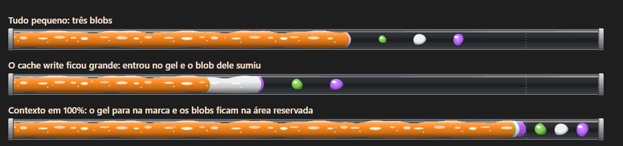
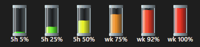
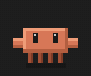
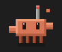
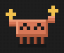
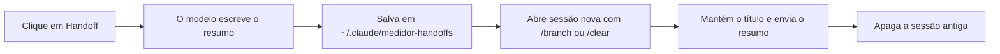

# claude-mods

Mods para o Claude Code. Por enquanto, um: o **medidor**.

# Medidor

Uma faixa acima do prompt que mostra para onde estão indo os seus tokens: contexto por tipo, custo, cache, velocidade e limites do plano, com um mascote e um botão de handoff.


## Instalar

```bash
claude plugin marketplace add mmacedok/claude-mods
```

```bash
claude plugin install medidor@claude-mods
```

Depois, reinicie o Claude Code. Dentro de uma sessão, o mesmo vale com `/plugin marketplace add mmacedok/claude-mods` e `/plugin install medidor@claude-mods`.

| Para | Comando |
|---|---|
| Atualizar | `claude plugin marketplace update claude-mods` e `claude plugin update medidor@claude-mods` |
| Desligar | `claude plugin disable medidor@claude-mods` |
| Remover | `claude plugin uninstall medidor@claude-mods` |

> Feito e testado no Windows. Em outros sistemas, a faixa deve funcionar, mas a cota do Gemini e o apagar da sessão antiga do Handoff dependem de caminhos e comandos do Windows.

## O que aparece na faixa

### Tubo de contexto

Do começo do tubo até a marca pontilhada é 100% da janela de contexto, em escala real. Cada gel ocupa exatamente a sua fração. À direita, o tubo mostra a porcentagem e `usados/janela`.

| Cor | Sigla | Tipo |
|---|---|---|
| Laranja | `CR` | Cache lido |
| Verde | `I` | Input |
| Branco | `CW` | Cache escrito |
| Roxo | `O` | Output |

O cache lido costuma ser tão maior que o resto que os outros tipos nem apareceriam. Por isso, cada um deles também vira um blob, na parte livre do tubo:



- **Tamanho:** cresce com a quantidade de tokens, em escala logarítmica, até 50k. Serve para ver a ordem de grandeza; o número exato está na legenda.
- **Mistura:** quando o pedaço do tipo no gel chega a 20 px de largura, o blob entra no gel e some.
- **Lugar garantido:** a ponta direita do tubo é reservada, então os blobs nunca ficam em cima do gel, nem com o contexto em 100%. Eles também nunca se encostam.


### Números

Cada tipo aparece como `agora/total da sessão`, por exemplo `CR 259k/8.10M`.

| Item | O que é |
|---|---|
| `hit 100%/97%` | Quanto da entrada veio do cache, na última resposta e na sessão. Verde a partir de 90%, amarelo a partir de 70%, vermelho abaixo disso |
| `$5.80` | Custo que o Claude Code informa. Com `≈` na frente, é uma estimativa feita com a tabela `PRECOS` do mod |
| `116 tok/s` | Velocidade da última resposta, do primeiro ao último pedaço, sem contar a espera até o modelo começar |
| `5h · resets in 3h 53m` | Quanto falta para o limite de 5 horas reiniciar. Fica vermelho a partir de 80% |
| `Skills:` | As 3 últimas skills usadas, mais `+N` se houver outras |
| `Gemini 5h 45%` | Cota do plano Google, que só aparece depois de usada |

A porcentagem do contexto fica vermelha a partir de 85%.

### Tubos de limite

Dois tubos verticais mostram o limite de 5 horas (`5h`) e o semanal (`wk`). Uma gota cai do alto e o gel acumula no fundo, indo do verde ao vermelho conforme o uso.



### Mascote

| Parado | Trabalhando | Depois de responder |
|---|---|---|
|  |  |  |
| Ciclo de 63 s: olha em volta, acena, dança, abre o laptop, sapateia, vira gelatina e espirra | Enquanto o Claude trabalha | Fica feliz por 4 segundos |

## Botões

| Botão | O que faz |
|---|---|
| **Mods** | Abre a lista de mods |
| **Stats** | Abre ou fecha o painel de uso. O comando `/stats` faz o mesmo |
| **Clear** | Roda `/clear` e zera o medidor |
| **Handoff** | Resume a conversa e continua numa sessão nova |

### Stats


Mostra o uso por modelo nesta sessão, com seções que abrem e fecham. A parte do Gemini usa duas fontes:

- **Cota:** vem do Antigravity CLI (`agy -p /usage`), lido a cada 2 minutos, sem gastar tokens. Sem o `agy` instalado, essa parte fica vazia.
- **Jobs:** vêm dos arquivos JSON em `~/.claude/medidor-gemini-logs`, se você tiver algo gravando neles.

### Handoff

Troca uma conversa longa por uma sessão nova que já sabe o que estava acontecendo.



> **Atenção:** o Handoff apaga o arquivo `.jsonl` da sessão antiga. O resumo fica salvo, mas a conversa original não volta.

O mod também avisa quando o Handoff compensa:


O aviso laranja aparece se o contexto passou de 60%, ou se a conversa já tem 8 mensagens e o Handoff se paga em até 5 mensagens. Fechado no ✕, ele volta 5 mensagens depois.

## Ajustes

Tudo fica em [`plugins/medidor/hooks/register.tsx`](plugins/medidor/hooks/register.tsx):

| Constante | O que muda |
|---|---|
| `PRECOS` | Preços usados na estimativa de custo |
| `ESFERA_FUNDE` | Largura, em px, em que o blob entra no gel |
| `BLOB_RESERVA` | Tamanho da área reservada aos blobs |
| `HANDOFF_PCT`, `HANDOFF_PAGA`, `HANDOFF_MIN_MSGS` | Quando o aviso de handoff aparece |

## Novidades

Veja o [histórico de versões](CHANGELOG.md).

---

As imagens foram geradas com o código de desenho do próprio mod. Os tubos e o mascote são os reais; a página em volta é uma montagem da faixa, e os números são de exemplo.
