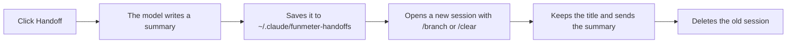

# claude-mods

Mods for Claude Code. For now, there is one: **FunMeter**.

# FunMeter

A live band above the prompt that shows where your tokens are going: context by token type, cost, cache hit, speed and plan limits, with a mascot and a Handoff button.


## Install

```bash
claude plugin marketplace add mmacedok/claude-mods
```

```bash
claude plugin install funmeter@claude-mods
```

Then restart Claude Code. Inside a session, you can use `/plugin marketplace add mmacedok/claude-mods` and `/plugin install funmeter@claude-mods` instead.

| To | Run |
|---|---|
| Update | `claude plugin marketplace update claude-mods`, then `claude plugin update funmeter@claude-mods` |
| Turn off | `claude plugin disable funmeter@claude-mods` |
| Remove | `claude plugin uninstall funmeter@claude-mods` |

**Used the old name?** FunMeter was called `medidor`. Remove it first with `claude plugin uninstall medidor@claude-mods`, or you will have two bands.

> Built and tested on Windows. On other systems the band should work, but the Gemini quota and deleting the old session in Handoff rely on Windows paths and commands.

## What the band shows

### Context tube

From the start of the tube to the dotted mark is 100% of the context window, at true scale. Each gel takes up exactly its share. To the right of the tube you see the percentage and `used/window`.

| Color | Label | Token type |
|---|---|---|
| Orange | `CR` | Cache read |
| Green | `I` | Input |
| White | `CW` | Cache write |
| Purple | `O` | Output |

While cache write, input or output is under 12% of cache read, it shows as bubbles of its color flowing through the orange gel, with a total area that matches its share. From 12% up it is its own layer, to the right of the orange.

The whole tube is 100% of the context window, at true scale. A layer too thin to see, or a type with no cache read to flow in, shows only in the legend.

### Numbers

Each type shows as `now/session total`, for example `CR 259k/8.10M`.

| Item | What it means |
|---|---|
| `hit 100%/97%` | How much of the input came from cache, for the last response and for the session. Green from 90%, yellow from 70%, red below that |
| `$5.80` | The cost Claude Code reports. With `≈` in front, it is an estimate from the mod's `PRECOS` price table |
| `116 tok/s` | Speed of the last response, from the first chunk to the last, not counting the wait before the model starts |
| `5h · resets in 3h 53m` | Time until the 5-hour limit resets. Turns red from 80% |
| `Skills:` | The last 3 skills used, plus `+N` if there are more |
| `Gemini 5h 45%` | Google plan quota, shown only after it has been used |

The context percentage turns red from 85%.

### Limit tubes

Two vertical tubes show the 5-hour limit (`5h`) and the weekly limit (`wk`), with a battery for today (`24h`) between them. A drop falls from the top and gel builds up at the bottom, going from green to red as you use more.

The `24h` battery starts full and drains as you spend today's share of the week: what is left of the week divided by the days until it resets. The days are counted back from the reset, and each share is set when that day starts, so spending less today raises tomorrow's. Past the share the number goes negative.


### Mascot

| Idle | Working | After a response |
|---|---|---|
|  |  |  |
| A 63-second cycle: looks around, waves, dances, opens a laptop, tap dances, wobbles and sneezes | While Claude is working | Happy for 4 seconds |

## Buttons

| Button | What it does |
|---|---|
| **Mods** | Opens the list of mods |
| **Stats** | Opens or closes the usage pane. The `/funstats` command does the same |
| **Clear** | Runs `/clear` and resets the meter |
| **Handoff** | Summarizes the conversation and continues in a new session |

### Stats


Shows usage by model for this session, in sections you can collapse. The Gemini part has two sources:

- **Quota:** comes from the Antigravity CLI (`agy -p /usage`), read every 2 minutes without spending tokens. Without `agy` installed, this part stays empty.
- **Jobs:** come from JSON files in `~/.claude/funmeter-gemini-logs`, if something of yours writes to them.

### Handoff

Swaps a long conversation for a new session that already knows what was going on.



> **Warning:** Handoff deletes the old session's `.jsonl` file. The summary is saved, but the original conversation does not come back.

FunMeter also tells you when a Handoff is worth it:


The orange warning appears when context passes 60%, or when the conversation has at least 8 messages and a Handoff would pay for itself within 5 messages. If you close it with ✕, it comes back 5 messages later.

## Settings

Everything is in [`plugins/funmeter/hooks/register.tsx`](plugins/funmeter/hooks/register.tsx):

| Constant | What it changes |
|---|---|
| `PRECOS` | Prices used for the cost estimate |
| `HANDOFF_PCT`, `HANDOFF_PAGA`, `HANDOFF_MIN_MSGS` | When the Handoff warning appears |

## What's new

See the [changelog](CHANGELOG.md).

---

The images were generated with the mod's own drawing code. The tubes and mascot are the real ones; the rest of the band is a mock-up and the numbers are examples.
